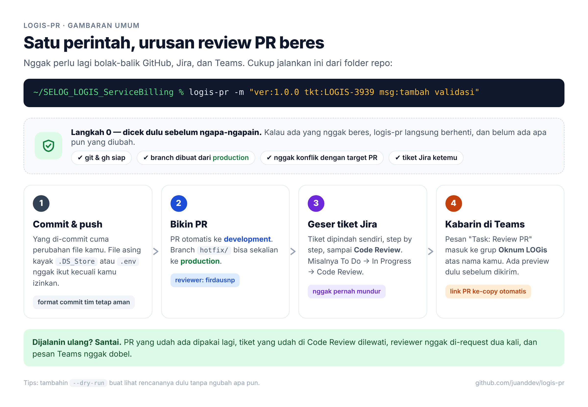
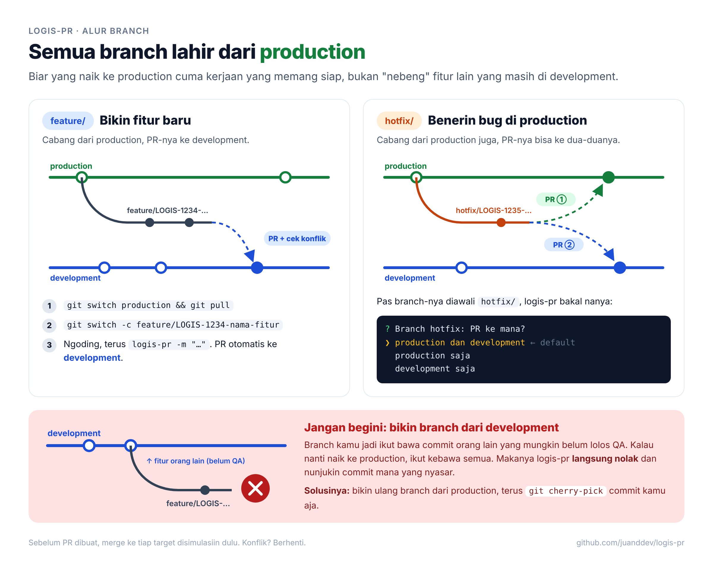
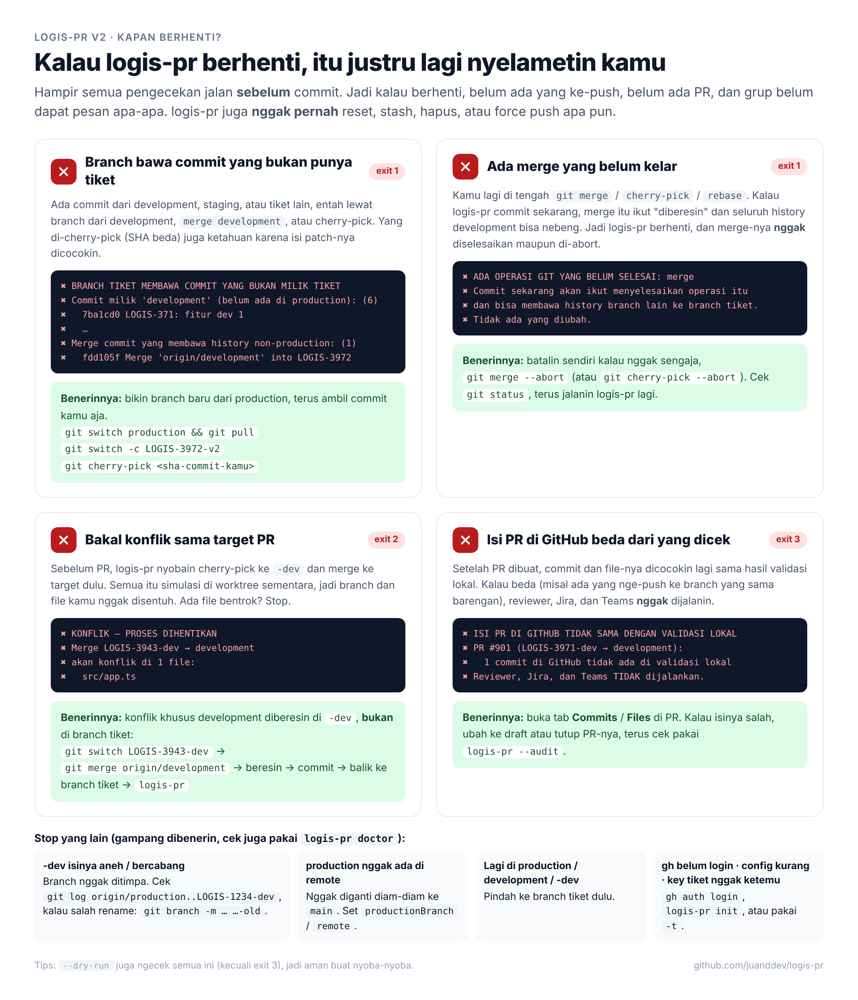
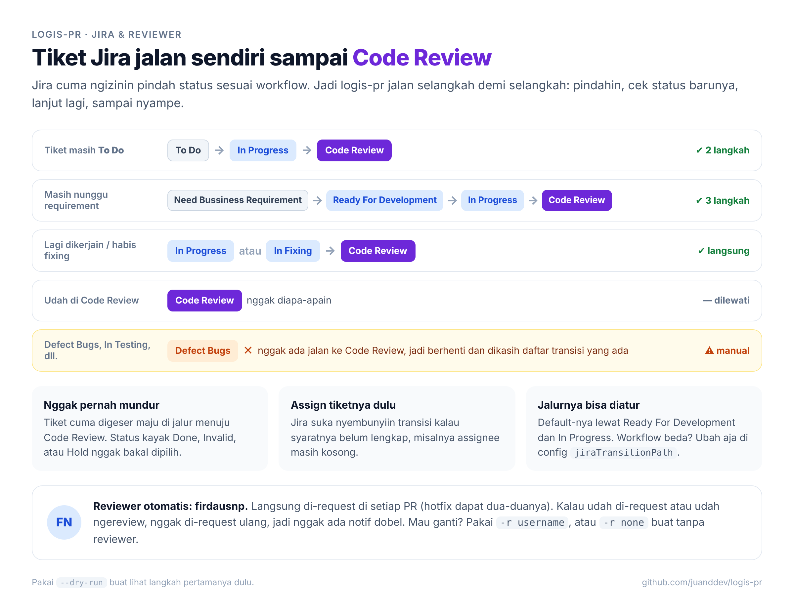
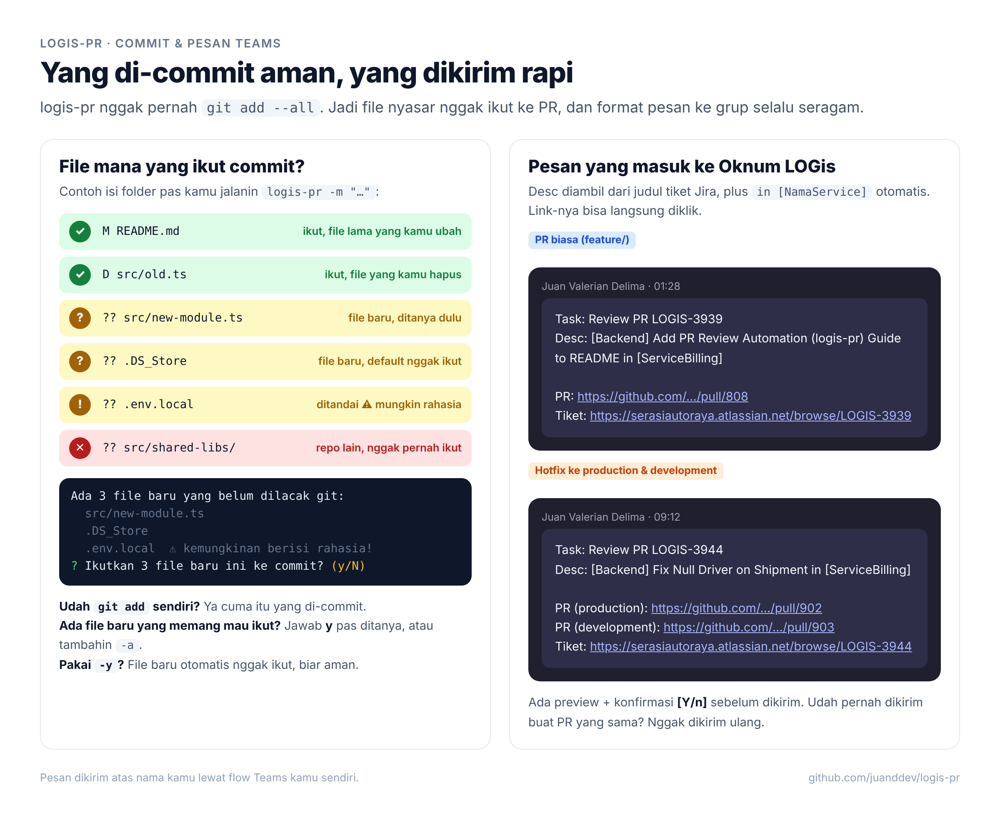

# logis-pr

CLI lintas platform (Windows 10/11 & macOS) untuk workflow review PR tim **LOGis**. Satu perintah:

```text
logis-pr -m "pesan commit"
```

menjalankan berurutan:

0. **Validasi isi branch & PR** — branch tiket harus berbasis `production` dan **hanya** berisi commit tiket: commit milik `development`/`staging` (SHA maupun hasil cherry-pick), commit branch tiket lain, merge non-production, atau merge yang sedang berjalan → **berhenti** sebelum ada commit/push/PR. Merge ke setiap target disimulasikan dulu; **konflik = berhenti**. Lihat [Alur branch](#alur-branch-production--logis-xxxx-dev--development).
1. **Commit** perubahan file yang sudah dilacak git (file baru ditanya dulu, lihat [File yang ikut commit](#file-yang-ikut-commit)) dengan prefix `LOGIS-XXXX: ` otomatis bila key tiket belum ada di pesan (format seperti `ver:1.0.0 tkt:LOGIS-3938 msg:...` dipakai apa adanya). Daftar commit tiket ditampilkan dan dikonfirmasi `[y/N]`.
2. **Branch integrasi `LOGIS-XXXX-dev`** — dibuat/diperbarui dari `production` dengan `git cherry-pick -x` commit tiket, lalu branch tiket & `-dev` di-push (tanpa force).
3. **Pull Request** via `gh`: `LOGIS-XXXX-dev → development` (branch `hotfix/…`: pilih **production dan development**, production saja, atau development saja; PR ke production langsung dari branch tiket). PR yang sudah ada dipakai ulang. Setelah PR dibuat, **isinya dicek ulang di GitHub** (commit & file harus sama dengan validasi lokal). Review otomatis diminta dari **`firdausnp`** (bisa diubah: `prReviewers` / `-r`).
4. **Jira → Code Review** via REST API v3, **bertahap** mengikuti workflow bila tidak bisa langsung (mis. `To Do → In Progress → Code Review`). Sudah di Code Review → dilewati. Tidak ada jalur → warning + daftar transisi, proses tetap lanjut. Lihat [Transisi Jira bertahap](#transisi-jira-bertahap).
5. **Teams** — preview pesan, konfirmasi `[Y/n]`, lalu kirim ke grup chat **Oknum LOGis** dengan format persis:

```text
Task: Review PR LOGIS-3938
Desc: [Backend] Enhance Bulk Last Route Location Response for Shipment and Driver Enrichment in [ServiceOrder]

PR: https://github.com/developerserasiautoraya/SELOG_LOGIS_ServiceOrder/pull/1886
Tiket: https://serasiautoraya.atlassian.net/browse/LOGIS-3938
```

Di akhir, link PR dicetak (stdout) dan disalin ke clipboard.



**Aman dijalankan ulang:** tidak ada PR ganda, tidak ada transisi ganda, dan pesan Teams untuk PR yang sama tidak dikirim dua kali (lihat [Idempotensi](#idempotensi)).

---

## Daftar isi

- [Prasyarat](#prasyarat)
- [Instalasi](#instalasi)
- [Konfigurasi](#konfigurasi)
- [Membuat Jira API token](#membuat-jira-api-token)
- [Setup Teams Workflows (grup chat Oknum LOGis)](#setup-teams-workflows-grup-chat-oknum-logis)
- [Fallback: Microsoft Graph API](#fallback-microsoft-graph-api)
- [Pemakaian](#pemakaian)
- [Idempotensi](#idempotensi)
- [Troubleshooting](#troubleshooting)
- [Pengembangan](#pengembangan)

---

## Prasyarat

| Tool | Versi | Catatan |
| --- | --- | --- |
| Node.js | ≥ 20 untuk menjalankan, ≥ 22.12 untuk build/test | Node 20 sudah EOL; disarankan Node 22 atau 24 LTS |
| git | ≥ 2.38 | dibutuhkan `git merge-tree --write-tree`; Windows: Git for Windows |
| GitHub CLI (`gh`) | ≥ 2.40 | harus sudah `gh auth login` |

Tidak butuh Bash, WSL, maupun Git Bash. Semua perintah eksternal dijalankan tanpa shell (array argumen), sehingga perilakunya identik di PowerShell, cmd, Windows Terminal, dan zsh.

## Instalasi

### Windows (PowerShell)

```powershell
winget install --id Git.Git
winget install --id GitHub.cli
winget install --id OpenJS.NodeJS.LTS
# TUTUP lalu buka lagi terminal agar PATH ter-refresh
gh auth login

cd C:\path\ke\logis-pr
npm install
npm run build
npm install -g .        # atau: npm link

logis-pr --version
logis-pr init
logis-pr doctor
```

npm membuat shim `logis-pr.cmd` dan `logis-pr.ps1` sehingga perintah bisa dipanggil dari PowerShell maupun cmd. Bila PowerShell menolak menjalankan `logis-pr.ps1` karena execution policy, jalankan sekali: `Set-ExecutionPolicy -Scope CurrentUser RemoteSigned`.

### macOS (zsh)

```bash
brew install git gh node
gh auth login

cd ~/path/ke/logis-pr
npm install
npm run build
npm install -g .        # atau: npm link

logis-pr --version
logis-pr init
logis-pr doctor
```

### Update

```text
git pull
npm install
npm run build
```

Karena `npm install -g .` membuat symlink ke folder ini, build ulang langsung berlaku tanpa install ulang.

## Konfigurasi

Config disimpan di `~/.logis-pr.json` (Windows: `%USERPROFILE%\.logis-pr.json`). Cara termudah membuatnya: `logis-pr init` (wizard interaktif; secret diketik dengan masking dan tidak pernah ditampilkan ulang). File ditulis dengan permission `600` di macOS.

Contoh isi:

```json
{
  "jiraBaseUrl": "https://serasiautoraya.atlassian.net",
  "jiraEmail": "nama@serasiautoraya.co.id",
  "jiraApiToken": "ATATT3x...",
  "jiraReviewStatus": "Code Review",
  "jiraTransitionPath": "Ready For Development, In Progress",
  "jiraProjectKey": "LOGIS",
  "teamsMode": "workflow",
  "teamsWebhookUrl": "https://....logic.azure.com/workflows/.../invoke?...&sig=...",
  "graphTenantId": "",
  "graphClientId": "",
  "graphChatId": "",
  "baseBranch": "development",
  "productionBranch": "production",
  "envBranches": "staging, development",
  "devBranchPattern": "{TICKET}-dev",
  "remote": "origin",
  "hotfixPrefixes": "hotfix/",
  "prReviewers": "firdausnp",
  "repoPrefix": "SELOG_LOGIS_"
}
```

Setiap field bisa di-override dengan environment variable (berguna untuk CI atau mesin bersama):

| Field | Env var | Default |
| --- | --- | --- |
| `jiraBaseUrl` | `LOGIS_PR_JIRA_BASE_URL` | `https://serasiautoraya.atlassian.net` |
| `jiraEmail` | `LOGIS_PR_JIRA_EMAIL` | — |
| `jiraApiToken` | `LOGIS_PR_JIRA_API_TOKEN` | — |
| `jiraReviewStatus` | `LOGIS_PR_JIRA_REVIEW_STATUS` | `Code Review` |
| `jiraTransitionPath` | `LOGIS_PR_JIRA_TRANSITION_PATH` | `Ready For Development, In Progress` |
| `jiraProjectKey` | `LOGIS_PR_JIRA_PROJECT_KEY` | `LOGIS` |
| `teamsMode` | `LOGIS_PR_TEAMS_MODE` | `workflow` (`graph` untuk fallback) |
| `teamsWebhookUrl` | `LOGIS_PR_TEAMS_WEBHOOK_URL` | — |
| `graphTenantId` | `LOGIS_PR_GRAPH_TENANT_ID` | — |
| `graphClientId` | `LOGIS_PR_GRAPH_CLIENT_ID` | — |
| `graphChatId` | `LOGIS_PR_GRAPH_CHAT_ID` | — |
| `baseBranch` | `LOGIS_PR_BASE_BRANCH` | `development` |
| `productionBranch` | `LOGIS_PR_PRODUCTION_BRANCH` | `production` (tidak pernah diganti diam-diam bila tidak ada) |
| `envBranches` | `LOGIS_PR_ENV_BRANCHES` | `staging, development` (commit-nya tidak boleh ada di branch tiket) |
| `devBranchPattern` | `LOGIS_PR_DEV_BRANCH_PATTERN` | `{TICKET}-dev` (nama branch integrasi untuk PR ke development) |
| `remote` | `LOGIS_PR_REMOTE` | `origin` |
| `hotfixPrefixes` | `LOGIS_PR_HOTFIX_PREFIXES` | `hotfix/` |
| `prReviewers` | `LOGIS_PR_REVIEWERS` | `firdausnp` (`none` = tanpa reviewer) |
| `repoPrefix` | `LOGIS_PR_REPO_PREFIX` | `SELOG_LOGIS_` |

Env lain: `LOGIS_PR_CONFIG` (lokasi file config lain), `LOGIS_PR_ASCII=1` (paksa simbol ASCII), `LOGIS_PR_ASCII=0` (paksa Unicode), `LOGIS_PR_DEBUG=1` (tampilkan stack trace untuk error tak terduga).

Contoh set env sementara:

```powershell
# PowerShell
$env:LOGIS_PR_BASE_BRANCH = "staging"; logis-pr -m "hotfix"
```

```bash
# zsh
LOGIS_PR_BASE_BRANCH=staging logis-pr -m "hotfix"
```

> **Secret:** `jiraApiToken` dan `teamsWebhookUrl` (berisi tanda tangan `sig=`) adalah kredensial. Jangan commit file config. `logis-pr` tidak pernah mencetaknya; `doctor` hanya menampilkan versi tersamar.

## Membuat Jira API token

1. Login ke Atlassian lalu buka https://id.atlassian.com/manage-profile/security/api-tokens.
2. Klik **Create API token** (token klasik, **bukan** "Create API token with scopes" — token ber-scope harus dipanggil lewat gateway `api.atlassian.com`, bukan URL site).
3. Beri label, mis. `logis-pr`, pilih masa berlaku, lalu **Create**.
4. Salin token (hanya ditampilkan sekali) dan tempel saat `logis-pr init`.
5. `jiraEmail` = email akun Atlassian yang membuat token.

Token punya tanggal kedaluwarsa. Saat kedaluwarsa, Jira membalas 401 — buat token baru dan jalankan `logis-pr init` lagi.

## Setup Teams Workflows (grup chat Oknum LOGis)

Incoming Webhook (connector lama) **tidak bisa** mengirim ke group chat. Solusinya flow Power Automate / Teams Workflows yang menerima HTTP request lalu memposting pesan **atas nama Anda**.

1. Buka https://make.powerautomate.com (atau app **Workflows** di Teams → *Create* → *Create from blank*), pastikan environment = tenant kantor.
2. **+ Create → Instant cloud flow → Skip**, beri nama `logis-pr → Oknum LOGis`.
3. Tambahkan trigger **Microsoft Teams → "When a Teams webhook request is received"**.
   - **Who can trigger the flow?** → **Anyone**. (Opsi "Any user in my tenant"/"Specific users" mewajibkan token Entra ID yang tidak dikirim oleh `logis-pr`.)
   - *Request Body JSON Schema* boleh dikosongkan. Bila ingin dynamic content, tempel:
     ```json
     {
       "type": "object",
       "properties": {
         "text": { "type": "string" },
         "html": { "type": "string" },
         "ticket": { "type": "string" },
         "desc": { "type": "string" },
         "prUrl": { "type": "string" },
         "ticketUrl": { "type": "string" },
         "source": { "type": "string" }
       }
     }
     ```
4. **+ New step → Microsoft Teams → "Post message in a chat or channel"**:
   - **Post as:** `User`
   - **Post in:** `Group chat`
   - **Group chat:** pilih **Oknum LOGis** (Anda harus anggota grup tersebut)
   - **Message:** klik ikon **fx** (tombol biru di kanan kolom Message) untuk membuka editor expression. Di kotak expression, ketik persis (TANPA garis miring `/` di depan):
     ```text
     triggerBody()?['html']
     ```
     lalu klik **Update**. Di kolom Message akan muncul chip `triggerBody()` — itu normal (Power Automate hanya menampilkan nama fungsinya). Field Message adalah editor HTML, sehingga `<br>` menjadi baris baru dan `<a href>` menjadi link yang bisa diklik.
     > Di designer baru, mengetik `/` **di kolom Message** hanya membuka menu *Insert expression*; jangan ikut mengetik `/` di kotak expression. Cek lewat *Code view* `</>` di kolom Message: isinya harus `@{triggerBody()?['html']}`.
5. **Save**. Buka lagi trigger, salin **HTTP URL** (muncul setelah disimpan).
6. Jalankan `logis-pr init`, pilih *Teams Workflows*, tempel URL tersebut.
7. Uji: `logis-pr doctor --test-teams` → pesan uji muncul di grup Oknum LOGis atas nama Anda.

Payload yang dikirim `logis-pr` (Content-Type `application/json`):

```json
{
  "text": "Task: Review PR LOGIS-3938\nDesc: ...\n\nPR: https://...\nTiket: https://...",
  "html": "Task: Review PR LOGIS-3938<br>Desc: ...<br><br>PR: <a href=\"https://...\">https://...</a><br>Tiket: <a href=\"https://...\">https://...</a>",
  "ticket": "LOGIS-3938",
  "desc": "...",
  "prUrl": "https://...",
  "ticketUrl": "https://...",
  "source": "logis-pr"
}
```

Semua nilai di `html` sudah di-escape (`& < > " '`), dan `href` hanya menerima `http(s)`.

## Fallback: Microsoft Graph API

Gunakan bila tenant memblokir Workflows/Power Automate. Pesan dikirim langsung lewat `POST /chats/{chat-id}/messages` atas nama Anda (delegated, device code flow — tidak perlu client secret).

1. Buka https://entra.microsoft.com → **App registrations → New registration**: nama `logis-pr`, *Accounts in this organizational directory only*.
2. **Authentication → Advanced settings → Allow public client flows = Yes** → Save.
3. **API permissions → Add → Microsoft Graph → Delegated**: `ChatMessage.Send`, `Chat.ReadBasic` (plus `offline_access`). Bila tenant tidak mengizinkan user consent, minta admin klik *Grant admin consent*.
4. Salin **Directory (tenant) ID** dan **Application (client) ID**.
5. `logis-pr init` → pilih *Microsoft Graph API* → isi tenant & client ID.
6. `logis-pr graph-login` → buka URL yang ditampilkan, masukkan kode, login.
7. `logis-pr graph-chats -n "Oknum LOGis"` → salin ID chat (`19:...@thread.v2`) ke `graphChatId` (via `logis-pr init` atau env `LOGIS_PR_GRAPH_CHAT_ID`).
8. `logis-pr doctor` untuk verifikasi.

Token disimpan di `~/.logis-pr-graph-token.json` (permission 600) dan diperbarui otomatis dengan refresh token.

## Pemakaian

```text
logis-pr [opsi]
logis-pr --audit [-t key] [-b branches]
logis-pr init | doctor [--test-teams] | graph-login | graph-chats [-n nama]
```

| Opsi | Keterangan |
| --- | --- |
| `-m, --message <pesan>` | pesan commit; prefix `LOGIS-XXXX: ` ditambahkan bila key tiket belum ada di pesan |
| `-t, --ticket <key>` | override key tiket dari nama branch (`LOGIS-3938` atau `3938`) |
| `-b, --base <branches>` | target PR dipisah koma, mis. `-b production` atau `-b production,development` (default: `development`; branch hotfix ditanya) |
| `-a, --all` | ikutkan file baru (untracked) ke commit tanpa ditanya |
| `-r, --reviewers <users>` | reviewer PR dipisah koma, override `prReviewers` (`-r none` = tanpa reviewer) |
| `-d, --draft` | buat PR sebagai draft |
| `-y, --yes` | lewati semua konfirmasi (termasuk daftar commit tiket): Teams dikirim, file baru **tidak** ikut (pakai `-a` bila perlu) |
| `--no-jira` | jangan pindahkan status tiket (summary tetap dibaca bila kredensial ada) |
| `--no-teams` | jangan kirim pesan Teams |
| `--dry-run` | tampilkan semua yang AKAN dilakukan; tidak commit/branch/push/PR/transisi/pesan (hanya `git fetch`, disebutkan di output) |
| `--audit` | periksa branch tiket, `-dev`, dan isi PR **tanpa mengubah apa pun** (tanpa fetch); exit 1 bila TIDAK AMAN |
| `-h, --help` / `-v, --version` | bantuan / versi |

Contoh:

```text
# Alur harian
logis-pr -m "tambah enrichment shipment & driver"

# Format commit tim: dipakai apa adanya (key tiket sudah ada → tanpa prefix tambahan)
logis-pr -m "ver:1.0.0 tkt:LOGIS-3938 msg:tambah enrichment shipment & driver"

# Sudah commit manual, tinggal push + PR + Jira + Teams
logis-pr

# Ada file baru (modul baru) yang memang mau di-commit
logis-pr -a -m "ver:1.0.0 tkt:LOGIS-3938 msg:tambah modul vehicle capacity"

# PR draft tanpa pengumuman
logis-pr -m "wip" -d --no-teams

# Branch tanpa key tiket, base staging, tanpa konfirmasi
logis-pr -t LOGIS-3938 -b staging -y

# Cek rencana dulu
logis-pr --dry-run -m "coba"

# Periksa apakah branch & PR saya bersih (read-only)
logis-pr --audit
```

Contoh output `--dry-run` (hasil nyata di repo uji):

```text
[i] Mode --dry-run: tidak ada commit, branch baru, push, PR, transisi Jira, maupun pesan Teams.
  Mutasi git yang tetap terjadi: git fetch (remote-tracking refs) dan objek sementara untuk simulasi
  (commit bayangan, cherry-pick di worktree sementara yang langsung dihapus). Branch, index, dan file Anda tidak berubah.

Validasi
[OK] Repo developerserasiautoraya/SELOG_LOGIS_ServiceOrder · branch tiket LOGIS-3971 · tiket LOGIS-3971
[OK] PR: LOGIS-3971-dev → development
  [dry-run] git fetch origin production development staging memperbarui remote-tracking refs.

[1/5] Branch tiket LOGIS-3971
[OK] Branch tiket berbasis 'production', 2 commit tiket:
    dbc1237 LOGIS-3971: tambah fitur
    (commit baru) LOGIS-3971: update panduan

[2/5] Validasi isi PR
[OK] buat 'LOGIS-3971-dev' dari production (titik awal branch tiket): 2 commit di-cherry-pick, 0 sudah ada
[OK] PR LOGIS-3971-dev → development: 2 commit tiket · 2 file

[3/5] Commit, push & Pull Request
[i] [dry-run] Akan commit 1 file: "LOGIS-3971: update panduan"
[i] [dry-run] Akan membuat branch 'LOGIS-3971-dev' (cherry-pick -x: dbc1237, commit baru) lalu push
[i] [dry-run] Akan push branch tiket: git push --set-upstream origin LOGIS-3971
[i] [dry-run] Akan membuat PR LOGIS-3971-dev → development
[i] [dry-run] Akan meminta review dari: firdausnp

[4/5] Jira → Code Review
[5/5] Teams → Oknum LOGis
[i] [dry-run] Pesan tidak dikirim.
```

`--dry-run` tetap melakukan **pembacaan** (git status, `gh pr list`, GET Jira) dan `git fetch` agar rencana akurat, tetapi tidak ada request yang mengubah apa pun dan branch/index/file Anda tidak berubah.

Log ditulis ke stderr; stdout hanya berisi link PR, sehingga bisa dipakai di skrip: `$pr = logis-pr -y` (PowerShell) atau `pr=$(logis-pr -y)` (zsh).

### Alur branch production → LOGIS-XXXX-dev → development





> Gambar di atas masih menggambarkan alur v1.3 (PR langsung dari branch tiket). Aturan terbaru ada di teks berikut dan di [ADR 0001](docs/adr/0001-production-based-ticket-branching-and-pr-isolation.md).

```text
production ──┬── LOGIS-1234 (branch tiket) ──────────────PR (hotfix / -b production)──▶ production
             │        │ cherry-pick -x (otomatis)
             └── LOGIS-1234-dev ──────────────────────────PR───────────────────────────▶ development
```

**1. Branch tiket wajib dari `production` dan hanya berisi commit tiket.** Setelah `git fetch`, logis-pr memeriksa setiap commit di branch tiket (yang belum ada di production), **termasuk commit yang akan dibuat** (dicek lewat commit bayangan, sebelum apa pun diubah). Berhenti (exit 1) bila menemukan:

| Temuan | Contoh penyebab |
| --- | --- |
| Commit milik `development`/`staging` | branch dibuat dari development, atau development di-merge |
| Salinan (cherry-pick) commit `development`/`staging` | `git cherry-pick` commit development (SHA beda, isi sama → dikenali lewat `git patch-id`) |
| Merge commit yang bukan dari production | merge development/staging/branch lain |
| Commit yang ada di branch tiket lain | merge `LOGIS-3920` ke branch Anda |
| Merge/cherry-pick/rebase **sedang berjalan** | `git merge development` yang belum di-commit (logis-pr tidak menyelesaikan maupun meng-abort-nya) |

Sinkron dengan production **boleh**: `git merge origin/production` dianggap *merge sinkronisasi*.

**2. PR ke development selalu dari `LOGIS-XXXX-dev`.** Branch ini dibuat dari titik awal branch tiket di production, lalu setiap commit tiket di-`cherry-pick -x` (simulasi di worktree sementara dulu, baru ref diperbarui secara atomik). Dijalankan ulang → hanya commit baru yang di-cherry-pick (fast-forward, tanpa force push). Isi `-dev` juga divalidasi: hanya cherry-pick commit tiket dan merge penyelesaian konflik dari development/production yang diizinkan; lokal & remote bercabang → berhenti.

**3. Isi PR divalidasi dua kali.** Sebelum push: commit `development..LOGIS-XXXX-dev` dan file `development...LOGIS-XXXX-dev` harus berasal dari commit tiket (plus *baseline* = commit production yang belum ada di development). Setelah PR dibuat/dipakai ulang: `gh pr view` harus cocok (head, base, ujung commit, daftar commit, jumlah file). Tidak cocok → **exit 3**, reviewer/Jira/Teams tidak dijalankan.

**4. Tidak boleh konflik.** Merge ke setiap target disimulasikan dengan `git merge-tree`. Konflik → **berhenti** (exit 2) sebelum commit, dengan warning besar dan daftar file.

> Konflik khusus development diselesaikan di **`LOGIS-XXXX-dev`**, bukan di branch tiket:
> ```text
> git switch LOGIS-1234-dev          # dibuat logis-pr, atau buat dari origin/production + cherry-pick -x
> git merge origin/development        # selesaikan konflik → commit
> git switch LOGIS-1234
> logis-pr                            # -dev dipakai ulang, merge penyelesaian konflik diizinkan
> ```

**5. Hotfix.** Branch berprefix `hotfix/` menanyakan target PR:

```text
? Branch hotfix: PR ke mana?
❯ production dan development
  production saja
  development saja
```

Dengan `-y`/non-interaktif, default **production dan development**: `hotfix/LOGIS-3944-… → production` dan `LOGIS-3944-dev → development`. Keduanya divalidasi, diberi reviewer, dan diumumkan dalam **satu** pesan Teams:

```text
Task: Review PR LOGIS-3944
Desc: [Backend] Fix ... in [ServiceBilling]

PR (production): https://github.com/.../pull/902
PR (development): https://github.com/.../pull/903
Tiket: https://serasiautoraya.atlassian.net/browse/LOGIS-3944
```

**Catatan baseline:** bila `production` punya commit yang belum ada di `development` (hotfix lama belum di-merge balik), commit itu ikut tampil di PR `-dev` sebagai baseline dan ditandai di output.

### Audit (`--audit`)

`logis-pr --audit` memeriksa keadaan sekarang **tanpa mengubah apa pun**: tanpa fetch, commit, branch, worktree, maupun push. Data remote memakai remote-tracking refs yang ada; kesegarannya dicek dengan `git ls-remote` (dibandingkan, tidak disimpan). Yang dilaporkan: operasi git yang belum selesai, isi branch tiket, status `-dev`, perkiraan isi PR, PR di GitHub (commit asing, PR lama dari branch tiket). Hasil akhirnya **AMAN** (exit 0) atau **TIDAK AMAN** (exit 1).

### Transisi Jira bertahap



Jira hanya mengizinkan perpindahan status sesuai workflow, dan API hanya memberi daftar transisi **dari status saat ini**. logis-pr menyusun jalur:

```text
jiraTransitionPath (status perantara)  +  jiraReviewStatus (target)
Ready For Development → In Progress   →  Code Review
```

Di setiap langkah, logis-pr memilih status **terjauh** di jalur yang tersedia dari status sekarang, memindahkan tiket, membaca ulang statusnya, lalu mengulang sampai Code Review:

| Status awal | Langkah |
| --- | --- |
| To Do | To Do → In Progress → Code Review |
| Need Bussiness Requirement | → Ready For Development → In Progress → Code Review |
| Ready For Development | → In Progress → Code Review |
| In Progress / In Fixing | → Code Review |
| Code Review | dilewati |
| Defect Bugs, In Testing, dll. | berhenti + warning (tambahkan `In Fixing` ke `jiraTransitionPath` bila ingin Defect Bugs → In Fixing → Code Review) |

Pengaman: tiket tidak pernah dimundurkan, dan status di luar jalur (Done, Invalid, Hold, …) tidak pernah dipilih. `--dry-run` menampilkan langkah pertama dan lanjutannya. Bila satu langkah gagal (mis. transisi mewajibkan field tertentu), logis-pr memberi tahu status terakhir tiket.

> Jira menyembunyikan transisi yang syaratnya belum terpenuhi (mis. assignee kosong). Bila logis-pr berhenti di To Do, cek apakah tiket sudah di-assign.

### Reviewer PR

Review otomatis diminta dari `prReviewers` (default `firdausnp`) lewat GitHub API, baik untuk PR baru maupun PR yang sudah ada. Reviewer yang sudah diminta atau sudah memberi review tidak diminta ulang (tidak ada notifikasi ganda), dan penulis PR otomatis dilewati. Gagal meminta review (mis. bukan collaborator repo) hanya memunculkan warning.

### File yang ikut commit



logis-pr **tidak pernah** menjalankan `git add --all`, supaya file yang tidak sengaja ada di folder (`.DS_Store`, config editor, `.env`, repo lain) tidak ikut ter-commit.

| Situasi | Yang di-commit |
| --- | --- |
| Sudah ada file yang Anda `git add` sendiri | **hanya** file yang di-stage itu (pilihan Anda dihormati) |
| Belum ada yang di-stage | perubahan file yang **sudah dilacak git** (`git add --update`: ubah & hapus) |
| Ada file baru (`??`) | ditampilkan, lalu ditanya *"Ikutkan file baru ini? [y/N]"* — default **tidak** |
| Ada file baru + `-a` | file baru ikut tanpa ditanya |
| Ada file baru + `-y` atau terminal non-interaktif | file baru **tidak** ikut, muncul warning |
| Folder repo git terpisah (mis. `src/shared-libs/`) | **tidak pernah** ikut, bahkan dengan `-a` |

File yang namanya mirip file rahasia (`.env*`, `*.pem`, `*.key`, `id_rsa`, `credentials`, `secrets`, `.npmrc`) diberi tanda ⚠ saat ditanyakan. `--dry-run` menampilkan file mana yang ikut dan mana yang tidak.

Saran: abaikan file sistem/editor secara global sekali saja:

```bash
printf '.DS_Store\n.zed/\n.idea/\n.vscode/\n' >> ~/.gitignore_global
git config --global core.excludesFile ~/.gitignore_global
```

### Validasi di awal (gagal = exit code 1, tanpa efek samping)

git & gh terpasang · gh sudah login · berada di repo git · tidak ada merge/cherry-pick/rebase yang sedang berjalan · bukan detached HEAD · bukan di branch production/staging/development/`-dev` · remote (`origin`) ada dan repo GitHub · branch production & target ada di remote (tidak diganti diam-diam) · key tiket ditemukan · config lengkap · ada perubahan tetapi `-m` tidak diberikan · tiket bisa diakses di Jira. Lalu: isi branch tiket bersih · `-dev` bersih · isi PR bersih · tidak konflik.

### Aturan isi pesan

- `Desc` = summary tiket Jira; bila belum diakhiri ` in [<Service>]` (case-insensitive) maka suffix itu ditambahkan. `Service` = nama repo tanpa `SELOG_LOGIS_`.
- Baris kosong antara `Desc` dan `PR` selalu ada; link PR & tiket bisa diklik.

## Idempotensi

| Situasi saat dijalankan ulang | Perilaku |
| --- | --- |
| Working tree bersih / tidak ada file yang ikut | tidak commit; push tetap dijalankan (no-op bila sudah sinkron) |
| PR open untuk head & base yang sama sudah ada | dipakai ulang, tidak membuat PR baru |
| `LOGIS-XXXX-dev` sudah ada | hanya commit tiket yang belum ada di-cherry-pick (dikenali dari trailer `-x`/patch-id); tidak ada yang baru → ref tidak berubah |
| Commit tiket sudah masuk development lewat `-dev` lama | tidak dianggap pencemaran dan tidak di-cherry-pick ulang |
| `gh pr create` balapan ("already exists") | PR yang ada untuk head **dan base** yang sama diambil |
| Tiket sudah di Code Review | tidak ada POST transisi |
| Reviewer sudah diminta / sudah review | tidak diminta ulang |
| Pesan Teams untuk PR ini sudah pernah dikirim | dengan `-y`: tidak dikirim ulang · interaktif: ditanya "Kirim ULANG?" default **Tidak** |

Catatan pengiriman disimpan di `~/.logis-pr-state.json` (per mesin).

## Troubleshooting

**"BRANCH TIKET MEMBAWA COMMIT YANG BUKAN MILIK TIKET"**
- Branch Anda membawa isi development/staging/tiket lain. Tidak ada yang di-push. Perbaikan (tidak menghapus apa pun):
  ```text
  git switch production && git pull
  git switch -c LOGIS-1234-v2
  git cherry-pick <sha commit Anda>      # lihat: git log --oneline origin/production..LOGIS-1234
  logis-pr
  ```
- Untuk sinkron, merge `origin/production` saja, jangan development/staging.

**"merge sedang berjalan"**
- Ada `git merge`/`cherry-pick`/`rebase` yang belum selesai. logis-pr tidak menyelesaikan maupun meng-abort-nya. Batalkan sendiri (`git merge --abort`) atau selesaikan, periksa `git status`, lalu jalankan lagi.

**"BRANCH INTEGRASI 'LOGIS-XXXX-dev' TIDAK BERSIH" / bercabang**
- `-dev` berisi commit selain cherry-pick commit tiket, atau lokal & remote berbeda arah. logis-pr tidak menimpa/menghapus branch. Periksa: `git log --oneline origin/production..LOGIS-1234-dev`. Bila memang salah: `git branch -m LOGIS-1234-dev LOGIS-1234-dev-old`, hapus branch remote secara manual bila perlu, lalu jalankan lagi.

**"BRANCH TIKET TIDAK BERSIH SETELAH COMMIT"**
- Commit sudah dibuat di lokal tetapi tidak di-push. Batalkan commit tanpa kehilangan perubahan: `git reset --soft HEAD~1`.

**"ISI PR DI GITHUB TIDAK SAMA DENGAN VALIDASI LOKAL" (exit 3)**
- Biasanya branch di GitHub berubah di antara validasi dan pembuatan PR (push orang lain). Buka tab Commits/Files di PR, ubah ke draft atau tutup bila salah, lalu `logis-pr --audit`.

**"Ada PR lama langsung dari branch tiket ke development"**
- Sejak v2.0.0, PR ke development berasal dari `LOGIS-XXXX-dev`. Tutup PR lama secara manual.

**Jira 401 (`Jira menolak kredensial`)**
- Email salah (harus email akun Atlassian), token salah/kedaluwarsa/dicabut, atau memakai token "with scopes". Buat token klasik baru → `logis-pr init` → `logis-pr doctor`.
- Pastikan `jiraBaseUrl` = `https://serasiautoraya.atlassian.net` (tanpa `/jira` atau path lain).

**Jira 404 untuk tiket**
- Key salah (cek nama branch, atau pakai `-t LOGIS-1234`), atau akun tidak punya akses Browse ke project.

**Transisi ke Code Review tidak tersedia**
- Workflow Jira tidak mengizinkan perpindahan langsung dari status saat ini (mis. dari *To Do*). `logis-pr` menampilkan daftar transisi yang ada — pindahkan dulu ke status perantara (mis. *In Progress*) lalu jalankan ulang, atau sesuaikan `jiraReviewStatus` bila nama status di board berbeda.

**Flow Teams gagal**
- `401/403`: trigger tidak di-set **Anyone**, atau URL sudah di-regenerate. Salin ulang HTTP URL.
- `404`: flow dihapus/dimatikan atau URL berubah.
- `400`: *Request Body JSON Schema* di trigger tidak cocok — kosongkan atau gunakan schema di atas.
- `202` tapi pesan tidak muncul: buka **My flows → (flow) → Run history** untuk melihat error action. Penyebab umum: akun pemilik koneksi bukan anggota grup Oknum LOGis, atau koneksi Teams di flow kedaluwarsa (perbaiki di *Connections*).
- Tag HTML tampil mentah: expression dimasukkan sebagai teks biasa. Hapus, lalu sisipkan lagi lewat *Insert expression* (`triggerBody()?['html']`), atau buka *code view* `</>` di field Message.
- URL lama `*.webhook.office.com` ditolak oleh `logis-pr` karena itu Incoming Webhook (tidak bisa ke group chat).
- Workflows diblokir tenant → gunakan [fallback Graph](#fallback-microsoft-graph-api).

**`gh` tidak ditemukan di PATH (Windows)**
- Pasang: `winget install --id GitHub.cli`, lalu **tutup semua jendela terminal** (dan VS Code) dan buka lagi — PATH baru tidak masuk ke terminal yang sudah terbuka.
- Cek: `where.exe gh`. Biasanya ada di `C:\Program Files\GitHub CLI\gh.exe`. Bila tidak muncul, tambahkan folder tersebut ke *Environment Variables → Path* (User).
- Terpasang lewat Scoop: pastikan `%USERPROFILE%\scoop\shims` ada di PATH.
- Setelah itu: `gh auth login`, lalu `logis-pr doctor`.

**`gh` belum login / tidak punya akses repo**
- `gh auth login` lalu `gh auth status`. Untuk org `developerserasiautoraya` dengan SSO, otorisasi token di GitHub (*Settings → Applications*) bila diminta.

**Push gagal / minta kredensial**
- `logis-pr` meneruskan stdin ke `git push`, sehingga Git Credential Manager (Windows) atau keychain (macOS) tetap bisa meminta login. Pastikan `git push` manual berhasil sekali.

**Pre-commit hook gagal**
- Pesan dari hook (husky/lint-staged) ditampilkan; perbaiki lalu jalankan ulang. Tidak ada PR/Jira/Teams yang dijalankan bila commit gagal.

**Simbol tampil sebagai kotak/tanda tanya di Windows**
- Gunakan Windows Terminal, atau `$env:LOGIS_PR_ASCII = "1"` untuk simbol ASCII (`[OK] [!] [X]`). Fallback ASCII otomatis aktif di conhost lama.

**Clipboard gagal**
- Windows memakai `clip.exe` (fallback `Set-Clipboard`), macOS `pbcopy`. Link tetap tercetak di akhir untuk disalin manual.

**Error tak terduga**
- Jalankan ulang dengan `LOGIS_PR_DEBUG=1` untuk stack trace (PowerShell: `$env:LOGIS_PR_DEBUG = "1"`).

## Pengembangan

```text
npm install
npm run dev -- --dry-run -m "coba"   # jalankan dari source (tsx)
npm run lint                         # ESLint + tsc --noEmit
npm test                             # vitest (repo git sungguhan di folder temp; HTTP & gh tiruan)
npm run build                        # bundel satu file: dist/cli.js
```

Struktur:

```text
src/
  cli/       index.ts (commander), run.ts (orkestrasi), audit.ts (--audit), init.ts, doctor.ts, graph.ts, prompt.ts
  config/    index.ts (file + env), state.ts (catatan pesan Teams terkirim)
  git/       index.ts (wrapper git tanpa shell), isolation.ts (provenance, branch -dev, validasi isi PR), flow.ts
  github/    wrapper gh (body PR via stdin, deteksi PR yang sudah ada)
  jira/      REST API v3 + pemilihan transisi
  teams/     workflow.ts (Power Automate), graph.ts (device code + Graph)
  message/   formatter: key tiket, Desc, pesan text/html, escape
  utils/     exec (cross-spawn), http (fetch), term (simbol/ASCII), secret, clipboard
test/        vitest; gitfixture.ts membuat remote/clone sementara (tidak pernah menyentuh repo Anda)
docs/adr/    keputusan arsitektur (ADR)
```

Semua dependensi (commander, picocolors, @inquirer/prompts, cross-spawn) dibundel ke `dist/cli.js`, sehingga runtime tidak butuh `node_modules`. Clipboard memakai utilitas bawaan OS (bukan clipboardy) karena biner fallback clipboardy tidak ikut saat dibundel.

CI (`.github/workflows/ci.yml`) menjalankan lint, build, test, dan smoke test instalasi global di `windows-latest` dan `macos-latest`, termasuk menjalankan bundel di Node 20.

### Ilustrasi dokumentasi

Gambar di `docs/images/` dibuat dari HTML di `docs/illustrations-src/`. Setelah mengubah HTML-nya, render ulang:

```text
NODE_PATH=$(npm root -g) node docs/illustrations-src/render.cjs
```

Butuh Playwright + Chromium (`npm i -g playwright && npx playwright install chromium`).
